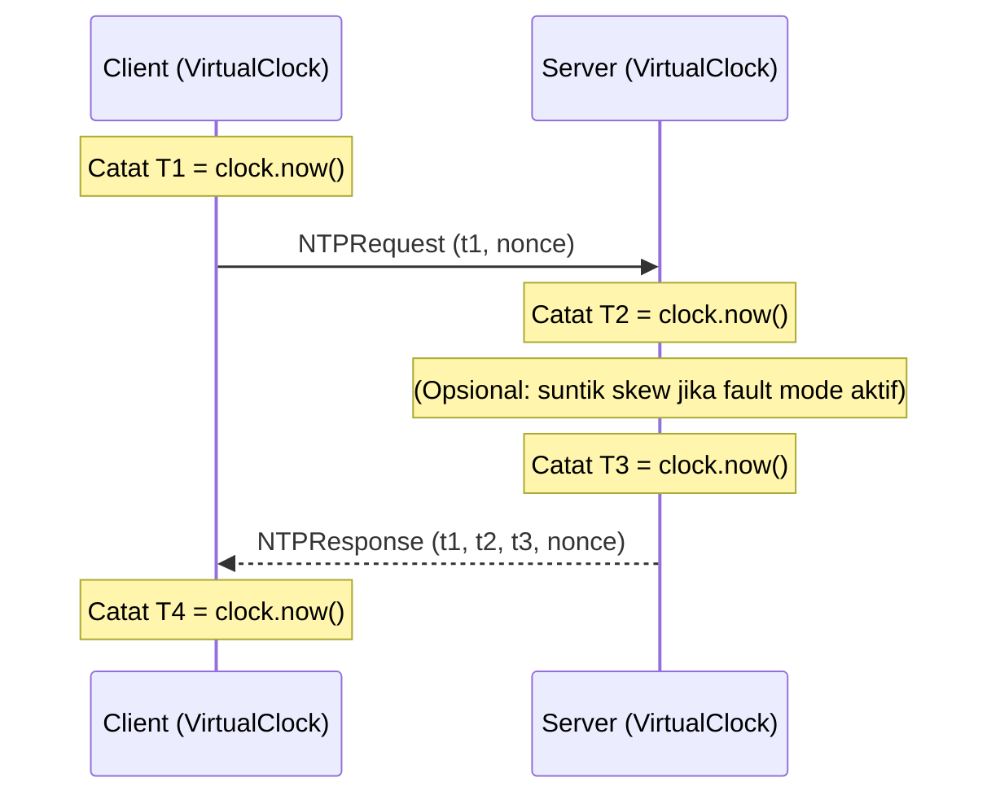
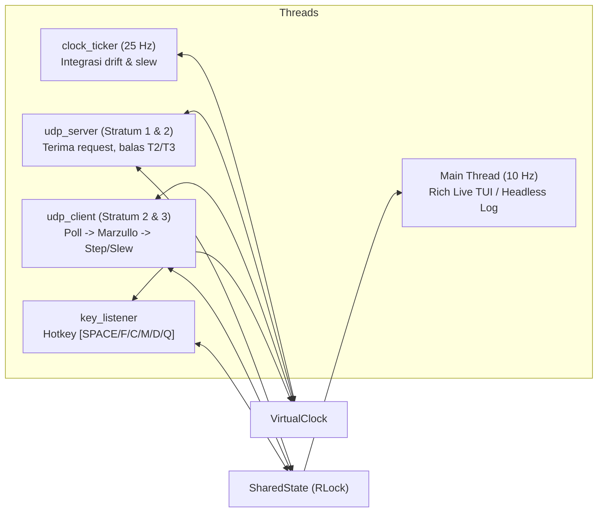

# Cara Kerja NTP Simulation: Penjelasan Bottom-Up

Dokumen ini menjelaskan bagaimana protokol NTP, algoritma konsensus Marzullo, mekanisme jam virtual, dan keseluruhan simulasi di repositori ini bekerja—disusun dari lapisan paling dasar (*bottom-up*) hingga ke tingkat arsitektur node dan cluster.

---

## Peta Lapisan (Bottom-Up)

```
Layer 5: Arsitektur Simulasi & Runtime (cli.py, state.py, ui.py, tmux)
   ▲
Layer 4: Penyesuaian Jam & Drift Fisik (clock.py — VirtualClock)
   ▲
Layer 3: Algoritma Konsensus & Filter Outlier (marzullo.py — Marzullo)
   ▲
Layer 2: Protokol Jaringan & Matematika 4-Timestamp (network.py — UDP)
   ▲
Layer 1: Fondasi Masalah & Struktur Data Paket (models.py)
```

---

## Layer 1: Fondasi — Masalah Waktu & Struktur Data

### Mengapa sinkronisasi waktu itu sulit?
Di sistem terdistribusi, setiap komputer punya jam perangkat keras sendiri berbasis osilator kristal kuarsa. Masalahnya:
1. **Tidak ada dua kristal yang identik.** Karena perbedaan suhu, usia komponen, dan toleransi pabrik, satu jam bisa berjalan sedikit lebih cepat atau lebih lambat dari jam lain (*clock drift*). Lama-kelamaan selisihnya menumpuk.
2. **Kita tidak bisa mengirim waktu secara instan.** Saat Server A mengirim pesan *"sekarang jam 10:00:00"*, pesan itu butuh waktu untuk melewati jaringan. Begitu sampai di Client B, jam 10:00:00 sudah lewat.
3. **Server bisa salah atau berbohong.** Sebuah server bisa saja jamnya melenceng parah (karena bug, konfigurasi salah, atau gangguan), lalu menyebarkan waktu yang keliru ke client.

Untuk mengatasi tiga masalah di atas, simulasi ini memodelkan paket dan data pengukuran secara terstruktur di `ntp_simulation/models.py`.

### Struktur Paket & Data Inti (`models.py`)

1. **`NTPRequest`** — Paket yang dikirim client ke server:
   - `t1`: Timestamp saat paket meninggalkan client (menurut jam lokal client).
   - `nonce`: String acak 16 karakter hex (`secrets.token_hex(8)`). Gunanya untuk mencocokkan balasan agar paket nyasar atau *replay* dari transaksi lama langsung ketahuan.
   - `client_id`: Identitas opsional pengirim.

2. **`NTPResponse`** — Paket balasan dari server ke client:
   - `t1`: Menyalin ulang `t1` dari request.
   - `t2`: Timestamp saat server menerima request (menurut jam server).
   - `t3`: Timestamp saat server mengirim balasan (menurut jam server).
   - `nonce`: Menyalin ulang `nonce` dari request.
   - `server_stratum`: Level hierarki server (`1`, `2`, atau `3`).
   - `is_falseticker` & `skew_applied`: Metadata simulasi untuk menandai apakah server sedang menyuntikkan gangguan waktu.

3. **`PeerSample`** — Hasil mentah dari satu kali polling ke satu server (`t1, t2, t3, t4`, status `RESPONDED` / `TIMEOUT` / `NONCE_MISMATCH`), yang otomatis menghitung **offset** ($\theta$) dan **round-trip delay** ($\delta$).

---

## Layer 2: Protokol NTP (RFC 5905) & Matematika 4-Timestamp

### Bagaimana Client Mengukur Selisih Jam Lewat Jaringan?
Karena waktu tempuh jaringan tidak nol, client tidak cukup hanya bertanya *"jam berapa sekarang?"*. Protokol NTP menggunakan **4 buah timestamp** dalam satu kali pertukaran paket UDP (`poll_peer` di `ntp_simulation/network.py`):



Begitu `NTPResponse` diterima dan `resp.nonce == req.nonce` terverifikasi, client memiliki empat titik waktu:
- **$T_1$**: Waktu berangkat dari client (jam client).
- **$T_2$**: Waktu tiba di server (jam server).
- **$T_3$**: Waktu berangkat dari server (jam server).
- **$T_4$**: Waktu tiba kembali di client (jam client).

### Penurunan Rumus Delay ($\delta$) dan Offset ($\theta$)

1. **Round-Trip Delay ($\delta$)** — Total waktu yang dihabiskan paket di perjalanan jaringan (pergi + pulang), dikurangi waktu proses di dalam server:
   $$\delta = (T_4 - T_1) - (T_3 - T_2)$$
   - $(T_4 - T_1)$ adalah total waktu tunggu menurut jam client.
   - $(T_3 - T_2)$ adalah waktu pemrosesan di sisi server (dihitung dengan jam server sendiri, jadi selisih jam antara client dan server saling meniadakan).

2. **Clock Offset ($\theta$)** — Perkiraan seberapa jauh jam client tertinggal atau mendahului jam server (nilai positif berarti jam client tertinggal dan perlu dimajukan):
   - Perjalanan pergi membutuhkan waktu sekitar $\delta / 2$. Jadi saat paket tiba di server, waktu client seharusnya $T_1 + \delta/2$, sementara jam server menunjukkan $T_2$. Selisihnya: $(T_2 - T_1) - \delta/2$.
   - Perjalanan pulang juga sekitar $\delta / 2$. Saat balasan tiba di client, waktu server seharusnya $T_3 + \delta/2$, sementara jam client menunjukkan $T_4$. Selisihnya: $(T_3 - T_4) + \delta/2$.
   - Jika kedua perkiraan ini dirata-ratakan, $\delta/2$ saling menghilangkan:
     $$\theta = \frac{(T_2 - T_1) + (T_3 - T_4)}{2}$$

> **Catatan praktis:** Rumus ini mengasumsikan latensi pergi dan pulang simetris ($\approx \delta/2$). Kalaupun asimetris, kesalahan estimasi $\theta$ paling besar tidak akan melebihi $\pm \delta/2$. Fakta inilah yang menjadi dasar *confidence interval* di Layer 3.

### Polling Paralel (`poll_peers_concurrently`)
Seorang client biasanya terhubung ke lebih dari satu upstream (misalnya Stratum 3 ke Relay A dan Relay B). Di `network.py`, `poll_peers_concurrently` menggunakan `ThreadPoolExecutor` untuk mengirim request ke semua upstream secara bersamaan, sehingga satu server yang *timeout* (1.5 detik) tidak menghambat pembacaan dari server lain.

---

## Layer 3: Algoritma Marzullo — Memilih Server yang Jujur

### Masalahnya: Bagaimana Jika Ada Server yang Salah?
Misalkan client bertanya ke 3 server:
- Server A bilang offset $+0.01\text{s}$
- Server B bilang offset $+0.02\text{s}$
- Server C bilang offset $+60.00\text{s}$ (rusak / *falseticker*)

Kalau client mengambil rata-rata begitu saja, hasilnya jadi $+20.01\text{s}$—semua jam ikut rusak. NTP membutuhkan algoritma untuk **membuang outlier** dan hanya mempercayai mayoritas yang konsisten. Di repositori ini, tugas tersebut dijalankan oleh **Algoritma Marzullo** (Keith Marzullo, 1984) di `ntp_simulation/marzullo.py`.

### Langkah 1: Mengubah Pengukuran Menjadi Interval Keyakinan
Karena ketidakpastian jaringan maksimal sebesar $\delta_i / 2$, maka nilai offset "kebenaran" menurut peer $i$ berada di dalam rentang:
$$I_i = \left[\theta_i - \left(\frac{\delta_i}{2} + \epsilon_{\text{floor}}\right),\ \theta_i + \left(\frac{\delta_i}{2} + \epsilon_{\text{floor}}\right)\right]$$

Di sini ada **`dispersion_floor`** ($\epsilon_{\text{floor}}$, default `0.050` detik atau `50ms`, sesuai konsep *synchronization distance floor* di RFC 5905). Mengapa ini penting?
- Pada simulasi lokal (`127.0.0.1`), $\delta_i$ sangat kecil (sering `< 1ms`).
- Tanpa $\epsilon_{\text{floor}}$, intervalnya menjadi sangat sempit (`±0.5ms`). Akibatnya, dua server jujur yang hanya berbeda `2ms` karena *quartz drift* tidak akan beririsan dan dianggap tidak sepakat.
- Dengan tambahan `50ms`, server jujur tetap beririsan membentuk konsensus, sedangkan *falseticker* yang melenceng puluhan detik tetap berada jauh di luar irisan.

> **Catatan untuk simulasi antar-device (LAN / Wi-Fi):**
> Nilai $\delta_i / 2$ memang otomatis membesar mengikuti latensi jaringan nyata, namun default `0.050` (50ms) bisa terasa terlalu ketat jika dijalankan di beberapa mesin fisik berbeda karena:
> 1. `VirtualClock` menumpang di atas jam OS masing-masing device (`time.time() + _offset`). Jika jam OS antar-device tidak sinkron atau *jitter* jaringan tinggi, selisih antar-relay jujur bisa melampaui `±50ms`.
> 2. Jika `--drift` aktif dengan `--interval` default (`4.0s`), *Brownian drift* ($\pm 25\text{ ms/s}$) bisa mengakumulasi selisih hingga `100ms` di antara dua siklus polling.
>
> Untuk skenario multi-device, longgarkan batas ini lewat flag CLI tanpa perlu mengubah kode—misalnya `--dispersion-floor 0.150` atau `0.200` (masih jauh di bawah skala *falseticker* puluhan detik), atau perkecil `--interval` menjadi `1.5`–`2.0` detik.

### Langkah 2: Sweep-Line Algorithm (`marzullo_intersection`)
Misalkan ada $n$ peer yang merespons. Algoritma mencari jumlah *falseticker* paling sedikit $f$ (dengan syarat mayoritas ketat $n - f > n/2$, atau $f \le \lfloor(n-1)/2\rfloor$) sehingga ada titik offset yang disepakati oleh minimal $n - f$ peer.

Prosesnya di `marzullo.py`:
1. **Deduplikasi peer:** Jika ada sampel ganda dari `peer_id` yang sama, hanya yang terbaru yang dipakai.
2. **Buat tabel endpoint:** Setiap interval $[low_i, high_i]$ dipecah menjadi dua kejadian:
   - `(low_i, -1, peer_id)` → menandakan interval dimulai (`-1`)
   - `(high_i, +1, peer_id)` → menandakan interval berakhir (`+1`)
3. **Urutkan endpoint:** Diurutkan menaik berdasarkan koordinat. Jika koordinatnya sama persis, titik mulai (`-1`) ditaruh **sebelum** titik akhir (`+1`) agar dua interval yang bersentuhan di satu titik tetap terhitung beririsan.
4. **Cari irisan mayoritas ($f = 0, 1, \dots, \lfloor(n-1)/2\rfloor$):**
   - Untuk setiap nilai $f$, target jumlah peer yang beririsan adalah `target_count = n - f`.
   - **Sapuan maju (kiri ke kanan):** Mulai `count = 0`, setiap ketemu event lakukan `count -= event_type` (jadi `-1` menambah `count`, `+1` mengurangi `count`). Titik pertama di mana `count >= target_count` menjadi batas bawah konsensus `c_low`.
   - **Sapuan mundur (kanan ke kiri):** Mulai `count = 0`, lakukan `count += event_type` dari ujung kanan. Titik pertama di mana `count >= target_count` menjadi batas atas konsensus `c_high`.
   - Jika `c_low <= c_high`, maka interval konsensus `[c_low, c_high]` ditemukan! Loop berhenti karena kita ingin $f$ sekecil mungkin.

```
Contoh visual (n = 3, f = 1, target_count = 2):

Peer A:      [----θA----]
Peer B:        [----θB----]
Peer C:                                       [----θC----]  (Falseticker +60s)
             ^ ^        ^ ^
Sweep maju:  1 2(c_low)
Sweep mundur:           2(c_high) 1
Irisan:        [--------]  (Disepakati oleh A & B)
```

### Langkah 3: Klasifikasi & Pemilihan Kandidat Terbaik
Setelah `[c_low, c_high]` ditemukan:
- **Klasifikasi:** Setiap peer yang intervalnya beririsan dengan `[c_low, c_high]` (yakni $\max(p_{\text{low}}, c_{\text{low}}) \le \min(p_{\text{high}}, c_{\text{high}})$) dilabeli **`[TRUECHIMER]`**. Sisanya dilabeli **`[FALSETICKER]`** dan dibuang.
- **Pemilihan satu peer (`chosen_peer`):** Dari semua `[TRUECHIMER]`, dipilih **satu** peer dengan `delay` ($\delta$) paling kecil (karena jalur jaringan terpendek memberi estimasi waktu paling akurat). Jika seri, dipilih yang `|theta|`-nya lebih kecil, lalu `peer_id` secara leksikografis.

> **Bagaimana jika $n = 2$ dan keduanya bertengkar?**
> Dengan $n = 2$, `max_allowed_f = (2 - 1) // 2 = 0`. Artinya **kedua server wajib sepakat**. Jika satu server melenceng, tidak ada mayoritas ketat (`n - f > n/2`), sehingga `has_consensus` bernilai `False` dan client tidak melakukan koreksi jam demi keamanan.

---

## Layer 4: `VirtualClock` — Cara Jam Digerakkan & Dikoreksi

Di simulasi ini, kita tidak mengubah jam sistem operasi asli (karena butuh hak akses root dan akan mengacaukan proses lain di OS). Sebagai gantinya, setiap node memiliki objek `VirtualClock` (`ntp_simulation/clock.py`) yang menyimpan selisih terhadap jam OS (`_offset`):

$$\text{Waktu Virtual} = \text{time.time()} + \text{\_offset}$$

Semua pembacaan dan perubahan dilindungi `threading.Lock` agar aman diakses bersamaan oleh server UDP, client worker, dan UI.

### 1. Simulasi Kerusakan Alami: Brownian Quartz Drift
Jika mode drift aktif (`[D]` atau `--drift`), `VirtualClock` meniru ketidakstabilan kristal kuarsa fisik melalui *random walk* terbatas:
- Setiap `1.2` detik, target kecepatan drift (`_drift_target`) digeser secara acak sebesar `±0.006 s/s` dan dibatasi maksimal **`±0.025 s/s` (±25 ms/s)**.
- Kecepatan drift saat ini (`_drift_rate`) mengejar target secara halus (*exponential relaxation*):
  $$\Delta D = (D_{\text{target}} - D_{\text{rate}}) \cdot \min(1.0,\ 2.0 \cdot \Delta t)$$
- Setiap kali `clock.tick()` atau `clock.now()` dipanggil, `_offset` bertambah sebesar `_drift_rate * elapsed`.

### 2. Dua Mode Koreksi Jam: `STEP` vs `SLEW`
Saat Layer 3 menghasilkan `chosen_peer` dengan offset `theta_val`, client menerapkan koreksi ke `VirtualClock` dengan salah satu dari dua cara:

| Mode | Cara Kerja | Kapan Cocok Dipakai? |
| :--- | :--- | :--- |
| **`STEP`** (`clock.step(theta)`) | Langsung menjumlahkan `_offset += theta` seketika dan mengosongkan antrean slew. | Saat awal startup atau selisih waktu sangat besar, di mana lonjakan waktu instan dapat ditoleransi. |
| **`SLEW`** (`clock.start_slew(theta)`) | Mengantrekan koreksi ke `_slew_remaining`, lalu mencicil perubahan `_offset` secara bertahap dengan laju maksimum **`0.40 s/s`**. | Saat sistem produksi berjalan. Karena laju slew lebih lambat dari laju berjalannya waktu nyata (`1.0 s/s`), jam virtual **tidak pernah berjalan mundur** (*monotonicity* terjaga) bahkan saat koreksi bernilai negatif. |

---

## Layer 5: Arsitektur Simulasi & Alur Kerja Node

### Topologi Hierarki Stratum
Simulasi memodelkan tiga tingkat hierarki waktu:
- **Stratum 1 (Master / Reference Clock):** Memulai jam dengan offset `0.0s` (dianggap sebagai sumber waktu UTC acuan). Hanya menjalankan UDP server, tidak melakukan polling ke upstream.
- **Stratum 2 (Relay):** Memulai dengan offset acak antara `±5s` hingga `±30s`. Menjalankan **dua peran sekaligus**: sebagai *client* yang melakukan sinkronisasi ke Stratum 1, dan sebagai *server* yang melayani Stratum 3.
- **Stratum 3 (Client):** Memulai dengan offset acak `±5s` hingga `±30s`. Hanya bertindak sebagai *client* yang melakukan polling ke beberapa Stratum 2 Relay dan menjalankan algoritma Marzullo.

### Siklus Hidup Thread dalam Satu Node (`cli.py`)
Saat `python3 -m ntp_simulation` dijalankan, fungsi `main()` mengorkestrasi beberapa thread latar belakang yang semuanya berkomunikasi lewat `VirtualClock` dan `SharedState`:



1. **`clock_ticker` (25 Hz / setiap 40ms):** Memanggil `clock.tick()` secara berkala agar *slewing* dan *Brownian drift* terus berjalan halus meskipun sedang tidak ada paket jaringan yang masuk.
2. **`udp_server` (`run_server`):** Mendengarkan paket UDP masuk pada `--port`. Jika node ini sedang dalam mode gangguan:
   - **Manual Falseticker (`[F]`):** Menambahkan `+60.0s` pada `t2` dan `t3` sebelum mengirim `NTPResponse`.
   - **Auto Chaos (`[C]`):** Dengan probabilitas 35%, menyuntikkan lonjakan acak `±30s` hingga `±90s` pada `t2` dan `t3`.
3. **`udp_client` (`client_worker`):** Setiap `--interval` detik (default `4.0s`):
   - Memanggil `poll_peers_concurrently()` ke semua upstream.
   - Menyerahkan hasil ke `marzullo_evaluate()` untuk mendapatkan `chosen_peer`.
   - Memanggil `clock.step()` atau `clock.start_slew()` berdasarkan mode aktif.
   - Menyimpan hasil evaluasi, history sinkronisasi, dan sampel offset ke `SharedState`.
4. **`SharedState` & UI Freeze (`[SPACE]`):**
   - `SharedState` menggunakan `threading.RLock()` dan *ring buffer* (`deque(maxlen=10)` untuk log/history, `deque(maxlen=30)` untuk grafik offset).
   - Saat user menekan `[SPACE]`, `SharedState.toggle_ui_pause()` membekukan satu salinan `TelemetrySnapshot`. Tampilan TUI berhenti di snapshot tersebut agar mudah diamati atau di-screenshot, sementara `clock_ticker`, `udp_server`, dan `udp_client` **tetap bekerja penuh di belakang layar**.

### Menjalankan Simulasi Multi-Node (`scripts/run_cluster_tmux.sh`)
Untuk melihat protokol dan algoritma Marzullo bekerja secara menyeluruh, script `scripts/run_cluster_tmux.sh` otomatis membangun cluster 6-node dalam satu layar `tmux` (1 Stratum 1 di `:5001`, 2 Stratum 2 Relay di `:5002` & `:5003`, serta 3 Stratum 3 Client di `:5004–:5006`).

Skenario eksperimen cepat yang bisa langsung dicoba di cluster tersebut:
- Tekan **`[F]`** di salah satu panel Stratum 2 (misalnya `:5002`) untuk menyuntikkan *falseticker* `+60s`.
- Perhatikan panel Stratum 3 Client: karena hanya ada 2 upstream (`:5002` dan `:5003`) dan keduanya berbeda `+60s`, client akan masuk ke kondisi **No Consensus** (menolak sinkronisasi daripada ikut tersesat)—membuktikan mekanisme proteksi mayoritas ketat $n - f > n/2$ pada Algoritma Marzullo.
- Jika Stratum 3 dihubungkan ke $\ge 3$ upstream (misalnya 2 jujur + 1 falseticker), algoritma Marzullo akan otomatis menandai node yang melenceng sebagai `[FALSETICKER]` dan tetap menyinkronkan jam ke node `[TRUECHIMER]` dengan *delay* terkecil.
